> Individual level strategies can be found [here.](https://github.com/lowkFATO/NC-Speedrunning/blob/main/il-strategies.md)

> Old Version (1.12.1) of the game can be downloaded [here.](https://www.apkmirror.com/apk/kotoba-games/nameless-cat/nameless-cat-1-12-1-release/)

## Terminology
Game mechanics will be named the following way:

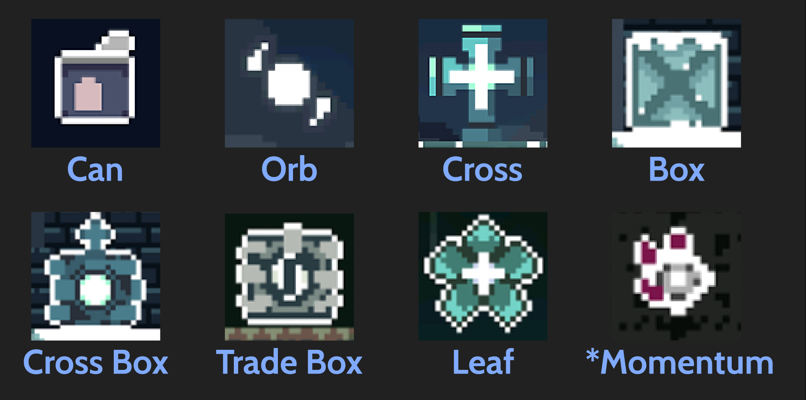

*has to be changes as soon as possible

## Mechanics Introduction

### Movement
Ground movement is pretty straightforward, you move at maximum horizontal speed immediately after tapping the Movement Button. The movement rate is constant and jumping at max movement speed does not change your velocity. But if you tap Jump Button before pressing Movement Button, you'll reach max speed slower.

Air movement uses acceleration. As previously mentioned, being airborne is initially slower, but there's no cap on acceleration.

### Early release jump buffering
When jump buffering, even if Jump Button was released before landing, the game will still register a jump, as can be seen below:

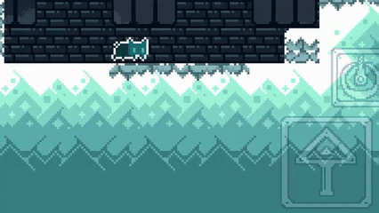

It can be annoying, but this feature is very useful, as it enables continuous jump buffering via spamming the Jump Button instead of having to properly time every next jump.

### Variable jump height
Jump height in this game is not constant. Buffered jump is ever so slightly higher than First jump. Although not very noticeable, this difference can make a huge impact, and in some levels increased height from Buffered jump is required for faster completion. Velocity does not impact jump height whatsoever.

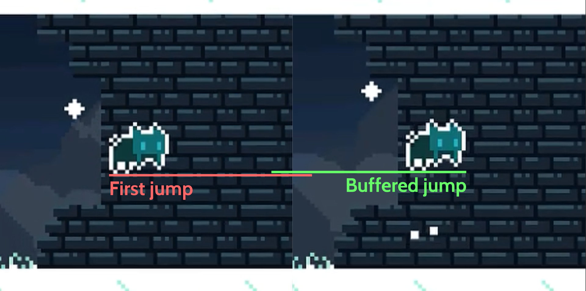

### High Jump (Glitch)
There's a way to gain a couple more pixels of extra height for both First and Buffered jumps. The setup looks like this:
> For High First jump, tap the Jump Button twice in a two frame window (use two fingers).

> For High Buffered jump, do the early release and then tap Jump Button exactly one frame after the Cat lands on (visibly touches) the ground.

Here's the difference between normal and high jumps:

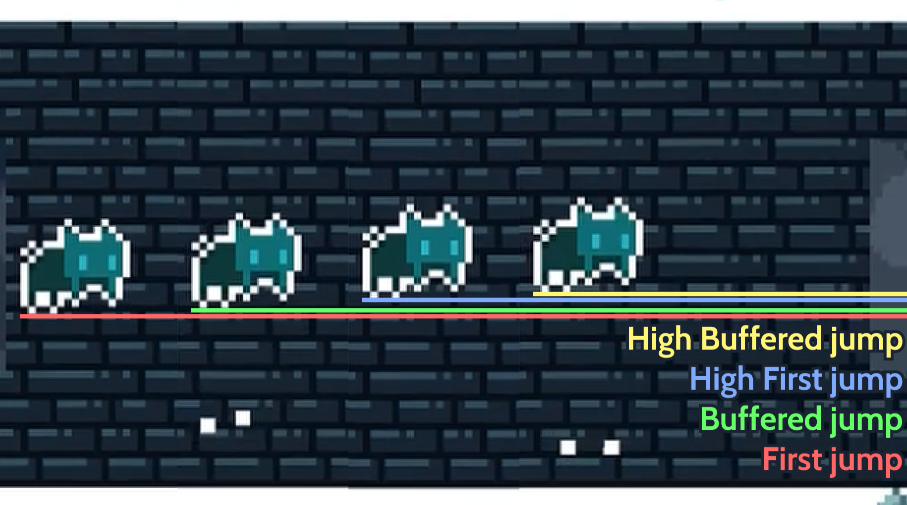

### Wooden platform jumping
You don't have to land on a wooden platform for the game to register a jump imput, you can jump off of it while airborne. This behavior allows using stacked on top of each other platforms for one big uninterrupted jump.

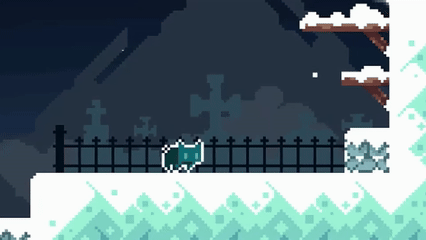

### Wooden Platform Box Clip (Glitch)
When pushing a Box, you can clip it through a wooden platform by jumping.

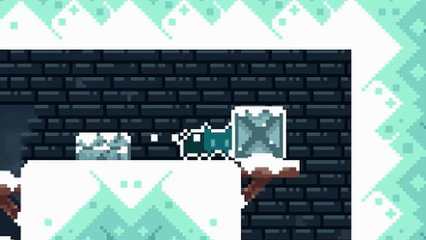

### Platform Clip (Glitch)
You can clip through platforms that are moving upwards. "The frame before the cat and the platform collide, you have significant downwards velocity while the platform is rising, after one frame passes, the cat should be in the lower zone of the platfrom (which only happens when the cat is very close to landing the previous frame and you have significant downwards velocity). This is what makes the trick so inconsistent, making so the cat is very close to landing but not yet landed so you land low enough to jump at a low enough height that the platform rises faster than you and you go through it." - Fodtrex, one of the top runners. There's no strategy for it, but jump timing for this glitch is not precise and can be buffered.

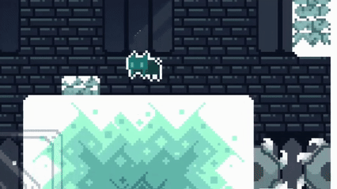

### Instant warp
It is possible to enter and instantly exit warp units by pressing Action and Jump Buttons in a single frame. Tapping just Action Button with two fingers works as well. Exampe of frame-perfect instant Cross warp is given below (entering Cross is possible strictly one frame after it lights up):

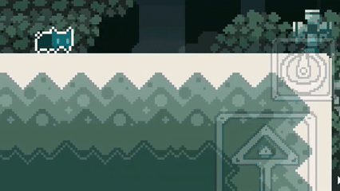

### Warp Jump (Glitch)
You can jump out of warp units. Two conditions have to be met for this glitch to work:
1. Cat is touching the ground when entering the warp unit.
2. Action and Jump buttons are pressed in a single frame while inside of the warp unit.

Here's how Warp Jump looks compared to normal Cross Box exit:

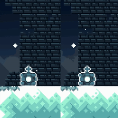

Trade Box can be used to perform multiple mid-air Warp Jumps in a row. The setup is as follows:
1. Place the Trade Box in the best available location. In all cases, this will be away from any other warp units.  
    - If you are trying to maximize height, put it as close to the cat as possible horizontally and as far above the cat as you can while still being able to warp to it after jumping.  
    - If you are trying to maximize distance, put it as close to the cat as possible vertically and as far away horizontally from the cat as you can while still being able to warp to it after jumping forwards.   
2. Put the cat in the desired position and jump.
3. Before the cat starts descending, press the Action button to trade with the box.
4. Immediately after, press both Jump and Action Buttons at the same time. The cat should appear to jump in mid-air after trading with the box.
5. Repeat steps 3 and 4 in a rhythmic pattern until you reach your desired location.

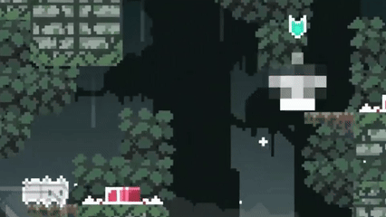

### Cross Exit Corner Boost (Glitch)
After exiting a Cross, if you spam the Jump Button, there's a chance to gain a significant momentum boost at the corner of a block, which will allow you to make a two block high jump. The mechanics behind this behavior are not understood yet, so there's no setup.

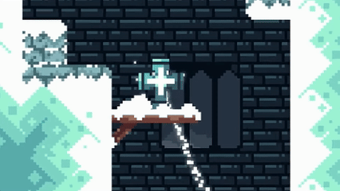

### Spike Corners (Glitch; Old Versions only)
You can stand on a block edge even if there's spike on it.

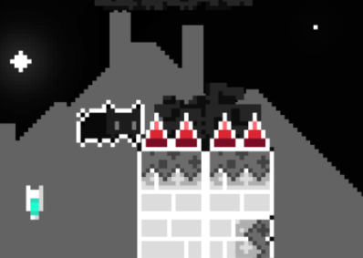

### Copycat (Glitch; Old Versions only)
When using the menu to reset (or go back home) while doing something with any type of Box, a new state of the cat appears when you reset. It cannot be controlled but still is a physical object and can only be pushed by other physical objects.

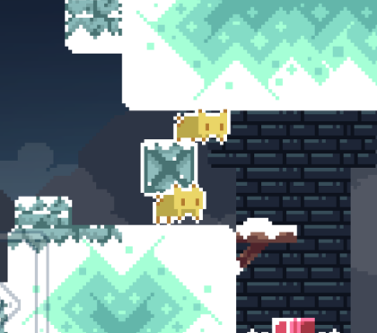

Most effects afflicted to Copycat instead are done to player, such as mushroom boosts, fan, death from 1-15 boss. The Copycat itself will not experience the effect. Copycat cannot be pushed by player, can only be indirectly pushed through blocks or though inconsistent when player is forcefully moved into it. E.g. jumping out of Cross. When falling does not accelerate. If they trigger snowball game freezes indefinitely unless you restart by tabbing out and loading game back up.

Having a block in contact with the Copycat gives totally new properties. If the Copycat is on a 1 way platform 3 things may occur:
1. You cannot pass through the 1 way platform in any capacity.
2. You can pass through the side.
3. It does nothing. It is consistent if you did the same thing in the same place but seemingly inconsistent throughout levels.

### Level State Manipulation (Glitch; Old Versions only)
Allows you to transfer checkpoints from one level to another by dying or restarting in a transition between levels.

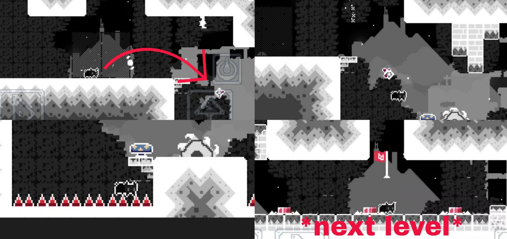

### Live Menu (Glitch)
The game can be active when the menu is still on. Allows for a larger variety of uses for Level State Manipulation because with it you can restart the level during transition. To do it, you have to:
1. Pause
2. Click "AD"
3. Use your phone's navigation and press the "back" button once
4. Click "Cancel"
> You cannot move after step 3 or 4 so you have to gain momentum first and then follow the steps

---

###### For game rules and submission rules, visit [this page.](https://github.com/lowkFATO/NC-Speedrunning/blob/main/rules.md "Rules Page")
###### For individual leves strategies, visit [this page.](https://github.com/lowkFATO/NC-Speedrunning/tree/main/il-strategies.md "Strategy page")
###### If you have questions or want to chat, join the [Discord Server.](https://discord.gg/5NFA6K5x7t "Kotoba Games Fandom server")
