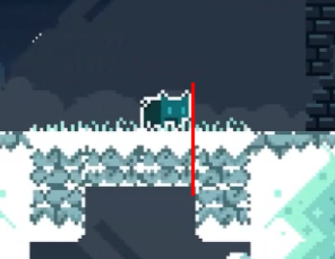
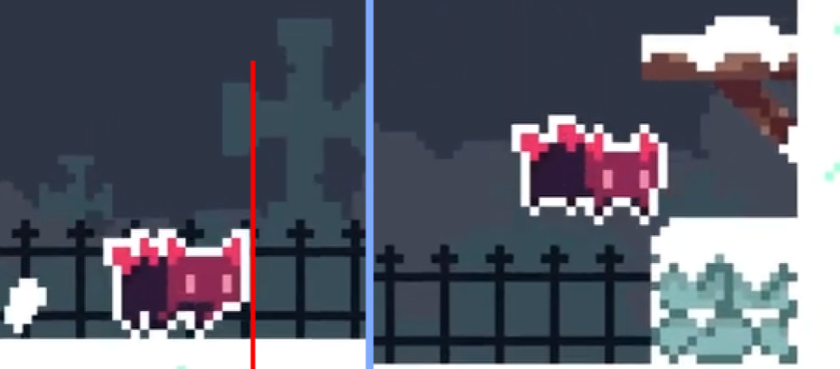

> It's highly advised to visit the [game mechanics page](https://github.com/lowkFATO/NC-Speedrunning/blob/main/game-mechanics.md "Game mechanics page") if you do not have full understanding of the terminology and strategies used on this page.

# Cathedral
## 1-1 Nameless Grave
### Any%
For first two jumps do a High First jump and a High Buffered jump. Buffer the rest of the jumps normally and you shouldn't bonk into the last block.

> Cat should jump right on the red line. Use ground for visual reference

WR run (t: 11.217, by: Jwnee)

https://github.com/user-attachments/assets/4c3471ea-8b40-4d00-b7cb-1ee7e7a2ad81

### 100%
## 1-2 Up
### Any%
Stand on the left edge of a moving platform. Run couple frames to the right, then do a High First jump. Jump before wooden platforms needs to be landed perfectly on an edge of a block. Second to last jump has to be a big wooden platform jump.

> Cat should jump right on the red line. Use the big cross in the background for reference.

WR run (t: 10.400, by: Fodtrex)

https://github.com/user-attachments/assets/b78c30d9-b115-413f-abae-82f3da24d316

### 100%
## 1-3 Cliff
### Any%
Perfect Instant Warp on every Cross, with a Warp Jump on second one.

WR run (t: 8.083, by: shefeedsoffnosebleeds)

https://github.com/user-attachments/assets/2e786419-6c6e-43a8-a1b4-6e4f93252e44

### 100%
## 1-4 Snow Valley
### Any%
Bonk your head against a ceiling at the start of the level for faster third Cross Warp Jump.

WR run (t: 10.333, by: DxS_Shyokii)

https://github.com/user-attachments/assets/6887d9a1-1737-44c6-8d3d-c06bafb751c2

### 100%
## 1-5 Enter Church
### Any%
Do a Cross Exit Corner Boost and clip the Box into the wooden platform.

WR run (t: 23.200, by: Jwnee)

https://github.com/user-attachments/assets/4e8918ca-0bb0-419f-a76b-ef16765c7ac5

### 100%
## 1-6 Trap
### Any%
Two instant warps allow to not wait for the spikes cycle.

WR run (t: 10.067, by: Fodtrex)

https://github.com/user-attachments/assets/226753e3-deb4-4df5-9845-4c8264f11a51

### 100%
## 1-7 More Trap
### Any%
### 100%
## 1-8 Deadly Blade
### Any%
### 100%
## 1-9 Moving platform
### Any%
### 100%
## 1-10 Those Tombstone
### Any%
### 100%
## 1-11 Puzzle
### Any%
### 100%
## 1-12 Easy Path
### Any%
### 100%
## 1-13 Double Puzzle
### Any%
### 100%
## 1-14 Monster Lair
### Any%
### 100%
## 1-15 The Gate
### Any%
### 100%

# Forest
## 2-1 Locked Door
### Any%
### 100%
## 2-2 Mineshaft
### Any%
### 100%
## 2-3 Red Plant
### Any%
### 100%
## 2-4 Strange Flower
### Any%
### 100%
## 2-5 Safe Rock
### Any%
### 100%
## 2-6 Exit
### Any%
### 100%
## 2-7 The Jungle
### Any%
### 100%
## 2-8 Danger Puzzle
### Any%
### 100%
## 2-9 Overgrown
### Any%
### 100%
## 2-10 Jump Higher
### Any%
### 100%
## 2-11 Attention
### Any%
### 100%
## 2-12 Sharp Platform
### Any%
### 100%
## 2-13 The Insect
### Any%
### 100%
## 2-14 On the Top
### Any%
### 100%
## 2-15 The Guardian
### Any%
### 100%

# Moon
## 3-1 The Moon
### Any%
### 100%
## 3-2 Timer
### Any%
### 100%
## 3-3 Vent
### Any%
### 100%
## 3-4 Floating Blade
### Any%
### 100%
## 3-5 Deadly City
### Any%
### 100%
## 3-6 Vanishing Platform
### Any%
### 100%
## 3-7 Cross Area
### Any%
### 100%
## 3-8 Avoid Void
### Any%
### 100%
## 3-9 Dodge It
### Any%
### 100%
## 3-10 The Blocking Wall
### Any%
### 100%
## 3-11 Straight Dart
### Any%
### 100%
## 3-12 Twin Puzzles
### Any%
### 100%
## 3-13 Greatest Puzzle
### Any%
### 100%
## 3-14 Void Switch
### Any%
### 100%
## 3-15 Last Battle
### Any%
### 100%

---

###### For game rules and submission rules, visit [this page.](https://github.com/lowkFATO/NC-Speedrunning/blob/main/rules.md "Rules Page")
###### For in-depth explanation of game mechanics, visit [this page.](https://github.com/lowkFATO/NC-Speedrunning/edit/main/game-mechanics.md "Game mechanics page")
###### If you have questions or want to chat, join the [Discord Server.](https://discord.gg/5NFA6K5x7t "Kotoba Games Fandom server")
